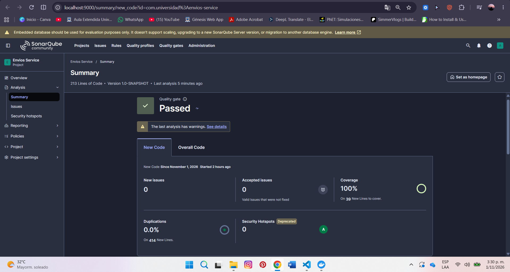
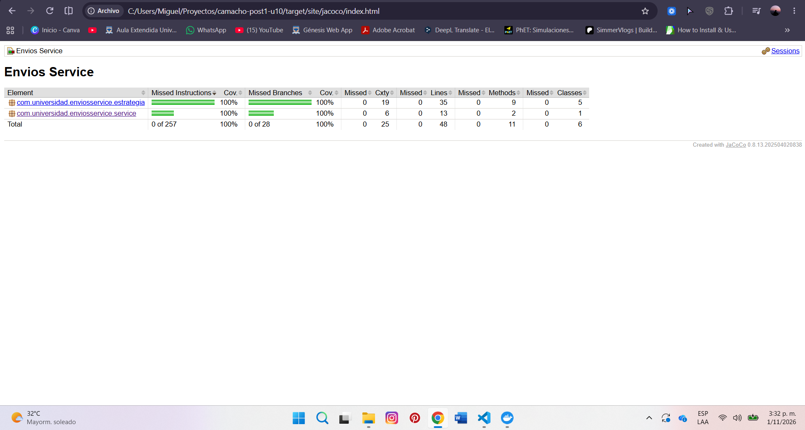

# Envios Service — Diagnóstico y Mejora Guiada por Métricas

## Decisiones de diseño
**1. Entorno de análisis:** Se seleccionó SonarQube Community Build ejecutado localmente mediante Docker, considerando dos criterios principales: la autonomía de configuración y el control del entorno de análisis.

En primer lugar, la instancia local permite administrar los Quality Profiles y Quality Gates necesarios para establecer reglas y umbrales personalizados. Esta capacidad resulta fundamental para la segunda parte del laboratorio, en la que se evaluará el cumplimiento de criterios específicos de complejidad, cobertura y duplicación.

En segundo lugar, el análisis local permite mantener un entorno de evaluación controlado, sin depender permanentemente de servicios externos ni de las restricciones funcionales de determinados planes en la nube. Docker facilita el aislamiento del servidor respecto al proyecto Maven y permite conservar su configuración mediante volúmenes persistentes.

Como contrapartida, esta alternativa exige recursos computacionales adicionales y mantener el servidor disponible durante los análisis. No obstante, estas limitaciones se consideran aceptables frente a la flexibilidad requerida para desarrollar las actividades de diagnóstico y mejora.

**2. Exclusiones del análisis:** Se decidió no establecer exclusiones mediante sonar.exclusions, debido a que la clase ServicioCalculoEnvio constituye el objeto principal del diagnóstico y concentra la lógica de negocio que se pretende evaluar.

Excluir total o parcialmente esta implementación reduciría artificialmente el alcance de las mediciones y comprometería la validez de la comparación posterior a la refactorización.

Asimismo, la separación entre src/main/java y src/test/java permite distinguir el código de producción del código de pruebas. Esta organización, junto con la importación del reporte XML de JaCoCo, hace innecesario excluir archivos relevantes para obtener las métricas de cobertura.

Por tanto, se mantiene el análisis completo del código de producción, priorizando la representatividad, trazabilidad y reproducibilidad de los resultados.

## Estado inicial del análisis
El diagnóstico inicial se realizó el 1 de noviembre de 2026, utilizando SonarQube Community Build, JaCoCo 0.8.13 y una suite de dos pruebas unitarias implementadas con JUnit Jupiter.

Las mediciones corresponden a la implementación original de ServicioCalculoEnvio, antes de aplicar patrones de diseño o ampliar la cobertura de pruebas.

| Métrica | Valor real observado |
| :--- | :---: |
| Complejidad ciclomática de `calcularCosto()` | 20 |
| Complejidad cognitiva agregada | 32 |
| Cobertura de líneas de `ServicioCalculoEnvio` | 23,8 % |
| Cobertura de ramas de `ServicioCalculoEnvio` | 18,4 % |
| Cobertura global de SonarQube | 21,3 % |
| Ramas sin cubrir | 31 de 38 |
| Cobertura de instrucciones (JaCoCo) | 14 % |
| Duplicación de código | 0,0 % |
| Asuntos abiertos de mantenibilidad | 0 |
| Pruebas unitarias ejecutadas | 2 |
| Fallos y errores de pruebas | 0 |

## Interpretación
El método ***calcularCosto()*** constituye el principal punto de atención, debido a que concentra las reglas de cálculo correspondientes a cuatro modalidades de envío: ESTANDAR, EXPRESS, OVERNIGHT e INTERNACIONAL. Su implementación utiliza una cadena de condicionales para seleccionar la modalidad, evaluar intervalos de peso, aplicar recargos o restricciones de distancia y realizar ajustes por fragilidad y tipo de cliente.

El reporte de JaCoCo evidenció que **31** de las **38 ramas** permanecen sin cubrir, lo que equivale a una cobertura de condiciones del 18,4 % según SonarQube.

La inspección del código fuente permitió identificar comportamientos no ejercitados por las pruebas iniciales, entre ellos:
- Los cálculos de las modalidades EXPRESS, OVERNIGHT e INTERNACIONAL.
- Los intervalos superiores de peso y los recargos por distancia.
- La restricción de distancia máxima para envíos OVERNIGHT.
- La aplicación del recargo por fragilidad y del descuento para clientes CORPORATIVO.
- El manejo de métodos de envío no soportados.

Estos resultados no demuestran que las reglas no verificadas sean incorrectas, sino que actualmente no existe evidencia automatizada suficiente para validar sus comportamientos.

**3. Métrica usada como señal principal:** Se seleccionó la ***complejidad ciclomática*** como métrica principal, debido a su relación directa con la cantidad de caminos independientes que introduce la lógica condicional del método calcularCosto().

El valor inicial de 20 establece una referencia cuantitativa para evaluar la efectividad de la refactorización. La mejora deberá reducir la concentración de decisiones en el método orquestador, distribuyendo las responsabilidades sin modificar las reglas de negocio existentes. La complejidad cognitiva se utilizará como indicador complementario de mantenibilidad, mientras que la cobertura de ramas permitirá comprobar si las nuevas pruebas ejercitan las alternativas inicialmente omitidas.

**4. Patrón elegido:** Se eligió ***Strategy (GoF)*** porque las condiciones de calcularCosto() seleccionaban cuatro algoritmos independientes según el método de envío. Se descartó State, al no existir estados internos ni transiciones, y Chain of Responsibility, porque las solicitudes no recorren una secuencia de manejadores.

La refactorización separó cada modalidad en una estrategia, manteniendo en ServicioCalculoEnvio los ajustes comunes de fragilidad y descuentos. Además, se incorporó CalculadoraTramosPeso para reutilizar cálculos compartidos entre ESTANDAR y EXPRESS. Como resultado, la complejidad ciclomática del método principal disminuyó de 20 a 5 (−75 %). 

**5. Criterio de pruebas agregadas:** La ampliación de las pruebas se fundamentó en el reporte inicial de JaCoCo, que registró 31 de 38 ramas sin cubrir. Las dos pruebas originales únicamente verificaban un envío ESTANDAR de bajo peso y la aplicación del descuento PREMIUM, por lo que gran parte de la lógica de negocio permanecía sin ejercitar. 

Se incorporaron pruebas unitarias y parametrizadas para verificar las modalidades ESTANDAR, EXPRESS, OVERNIGHT e INTERNACIONAL. Los escenarios contemplaron los tres intervalos de peso, incluidos los valores límite de 5 y 20 kg, así como los recargos por distancia correspondientes a cada modalidad.

Se verificaron también las restricciones específicas, especialmente la distancia máxima de 300 km para OVERNIGHT, comprobando mediante assertThrows que el sistema rechaza una solicitud de 301 km. Para las demás modalidades se incluyeron escenarios que ejercitan las condiciones de recargo al superar los límites establecidos.

Adicionalmente, se amplió ServicioCalculoEnvioTest para comprobar el incremento por fragilidad, el descuento CORPORATIVO, la combinación de ambos ajustes y el rechazo de métodos de envío no soportados. Se conservaron las dos pruebas iniciales como verificación de regresión.

También se incorporaron pruebas de fragilidad, descuento CORPORATIVO y métodos no soportados, conservando las pruebas originales. Cada escenario comprueba un resultado esperado o una excepción, evitando pruebas superficiales. La cobertura final de ramas alcanzó el 100 %.

**6. Realismo del Quality Gate:** Se configuraron el Quality Profile y el Quality Gate Estándar Laboratorio, estableciendo un límite de CC ≤ 10 por método mediante la regla java:S1541. Según la Tabla 3.2 de la guía, este valor corresponde al máximo del rango moderado (5–10), considerado aceptable bajo seguimiento y pruebas. A partir de CC = 11, la complejidad se clasifica como alta y se recomienda refactorizar. Por tanto, el umbral permite controlar métodos complejos sin exigir que todos alcancen el nivel bajo (1–4).

Asimismo, se estableció una cobertura global mínima del 70 %, considerada exigente pero más realista que imponer un 100 %, lo cual podría incentivar pruebas superficiales. Se añadieron condiciones de duplicación máxima del 5 % y cero nuevos problemas de mantenibilidad, esta última mediante Maintainability Issues en SonarQube MQR.

El análisis final obtuvo Quality Gate: Passed, con una cobertura del 100 %, duplicación del 0 % y ningún problema abierto de mantenibilidad, cumpliendo los criterios establecidos sin flexibilizar los umbrales.

## Comparación antes / después
| Métrica | Antes (Parte 1) | Después (Parte 2) |
| :--- | :---: | :---: |
| Complejidad ciclomática de `calcularCosto()` | 20 | 5 |
| Cobertura de ramas | 18,4 % | 100 % |
| Cobertura de líneas | 23,8 % | 100 % |
| Cobertura global | 21,3 % | 100 % |
| Ramas sin cubrir | 31 de 38 | 0 de 28 |
| Problemas abiertos de mantenibilidad | 0 | 0 |
| Duplicación de código | 0,0 % | 0,0 % |
| Quality Gate | No configurado | Passed |

## Capturas 

## Herramientas utilizadas
- Java 21, Apache Maven
- SonarQube Community Edition o SonarCloud, JaCoCo, Docker (si aplica)
- Git, GitHub

## Conclusiones
Este laboratorio permitió comprender la importancia de herramientas como SonarQube y JaCoCo para generar reportes con métricas reales que facilitan evaluar la calidad del software e identificar oportunidades de mejora. Uno de los aprendizajes más relevantes fue reconocer cómo la complejidad ciclomática puede evidenciar problemas de mantenibilidad, como ocurrió con el método calcularCosto(), cuya complejidad logramos reducir mediante el patrón Strategy. Asimismo, las pruebas unitarias resultaron fundamentales para verificar las reglas de negocio, mejorar la cobertura y asegurar que la refactorización conservara el comportamiento esperado. Finalmente, la detección y corrección de código duplicado demostró que las herramientas de análisis permiten orientar mejoras continuas y tomar decisiones técnicas fundamentadas, más allá de conseguir que el programa simplemente funcione.