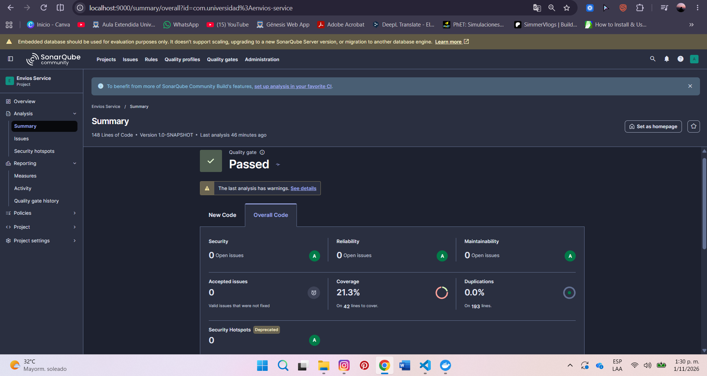
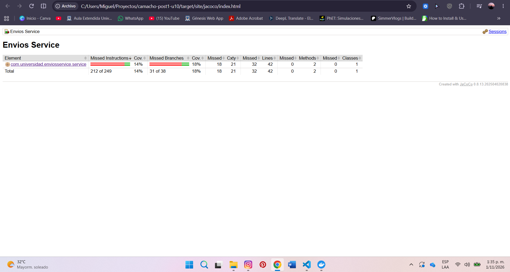
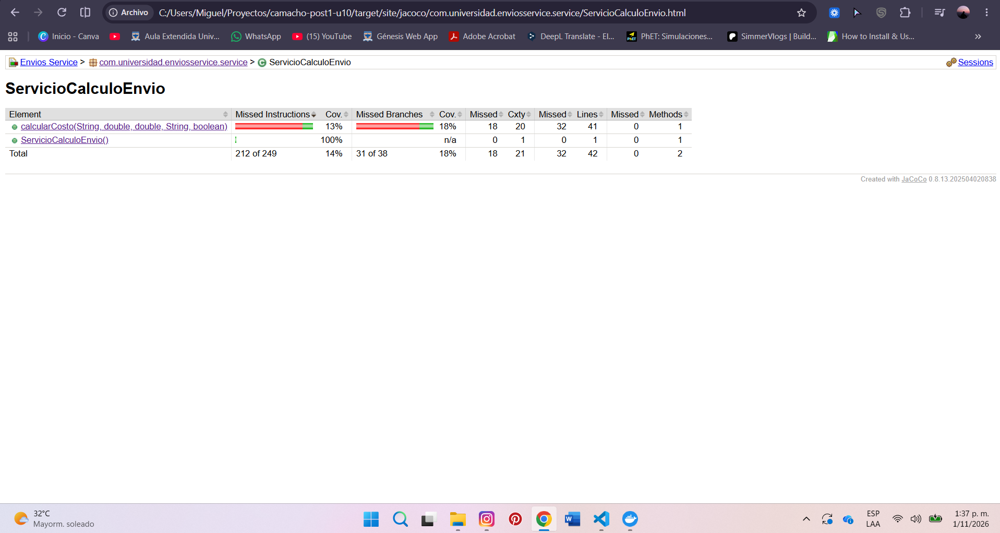

# Envios Service — Diagnóstico y Mejora Guiada por Métricas

## Decisiones de diseño
1. **Entorno de análisis:** Se seleccionó SonarQube Community Build ejecutado localmente mediante Docker, considerando dos criterios principales: la autonomía de configuración y el control del entorno de análisis.

En primer lugar, la instancia local permite administrar los Quality Profiles y Quality Gates necesarios para establecer reglas y umbrales personalizados. Esta capacidad resulta fundamental para la segunda parte del laboratorio, en la que se evaluará el cumplimiento de criterios específicos de complejidad, cobertura y duplicación.

En segundo lugar, el análisis local permite mantener un entorno de evaluación controlado, sin depender permanentemente de servicios externos ni de las restricciones funcionales de determinados planes en la nube. Docker facilita el aislamiento del servidor respecto al proyecto Maven y permite conservar su configuración mediante volúmenes persistentes.

Como contrapartida, esta alternativa exige recursos computacionales adicionales y mantener el servidor disponible durante los análisis. No obstante, estas limitaciones se consideran aceptables frente a la flexibilidad requerida para desarrollar las actividades de diagnóstico y mejora.

2. **Exclusiones del análisis:** Se decidió no establecer exclusiones mediante sonar.exclusions, debido a que la clase ServicioCalculoEnvio constituye el objeto principal del diagnóstico y concentra la lógica de negocio que se pretende evaluar.

Excluir total o parcialmente esta implementación reduciría artificialmente el alcance de las mediciones y comprometería la validez de la comparación posterior a la refactorización.

Asimismo, la separación entre src/main/java y src/test/java permite distinguir el código de producción del código de pruebas. Esta organización, junto con la importación del reporte XML de JaCoCo, hace innecesario excluir archivos relevantes para obtener las métricas de cobertura.

Por tanto, se mantiene el análisis completo del código de producción, priorizando la representatividad, trazabilidad y reproducibilidad de los resultados.

## Estado inicial del análisis
El diagnóstico inicial se realizó el 1 de noviembre de 2026, utilizando SonarQube Community Build, JaCoCo 0.8.13 y una suite de dos pruebas unitarias implementadas con JUnit Jupiter.

Las mediciones corresponden a la implementación original de ServicioCalculoEnvio, antes de aplicar patrones de diseño o ampliar la cobertura de pruebas.

| Métrica | Valor real observado |
| :--- | :---: |
| Complejidad ciclomática de `calcularCosto()` | 20 |
| Complejidad cognitiva agregada | 32 |
| Cobertura de líneas de `ServicioCalculoEnvio` | 23,8 % |
| Cobertura de ramas de `ServicioCalculoEnvio` | 18,4 % |
| Cobertura global de SonarQube | 21,3 % |
| Ramas sin cubrir | 31 de 38 |
| Cobertura de instrucciones (JaCoCo) | 14 % |
| Duplicación de código | 0,0 % |
| Asuntos abiertos de mantenibilidad | 0 |
| Pruebas unitarias ejecutadas | 2 |
| Fallos y errores de pruebas | 0 |

## Interpretación
El método ***calcularCosto()*** constituye el principal punto de atención, debido a que concentra las reglas de cálculo correspondientes a cuatro modalidades de envío: ESTANDAR, EXPRESS, OVERNIGHT e INTERNACIONAL. Su implementación utiliza una cadena de condicionales para seleccionar la modalidad, evaluar intervalos de peso, aplicar recargos o restricciones de distancia y realizar ajustes por fragilidad y tipo de cliente.

El reporte de JaCoCo evidenció que **31** de las **38 ramas** permanecen sin cubrir, lo que equivale a una cobertura de condiciones del 18,4 % según SonarQube.

La inspección del código fuente permitió identificar comportamientos no ejercitados por las pruebas iniciales, entre ellos:
- Los cálculos de las modalidades EXPRESS, OVERNIGHT e INTERNACIONAL.
- Los intervalos superiores de peso y los recargos por distancia.
- La restricción de distancia máxima para envíos OVERNIGHT.
- La aplicación del recargo por fragilidad y del descuento para clientes CORPORATIVO.
- El manejo de métodos de envío no soportados.

Estos resultados no demuestran que las reglas no verificadas sean incorrectas, sino que actualmente no existe evidencia automatizada suficiente para validar sus comportamientos.

3. **Métrica usada como señal principal:** Se seleccionó la ***complejidad ciclomática*** como métrica principal, debido a su relación directa con la cantidad de caminos independientes que introduce la lógica condicional del método calcularCosto().

El valor inicial de 20 establece una referencia cuantitativa para evaluar la efectividad de la refactorización. La mejora deberá reducir la concentración de decisiones en el método orquestador, distribuyendo las responsabilidades sin modificar las reglas de negocio existentes. La complejidad cognitiva se utilizará como indicador complementario de mantenibilidad, mientras que la cobertura de ramas permitirá comprobar si las nuevas pruebas ejercitan las alternativas inicialmente omitidas.

## Capturas del análisis inicial

